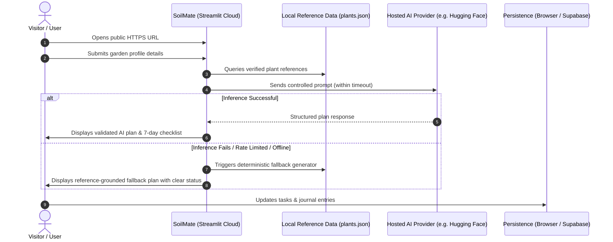

# SoilMate — Fully Online, Free-Hosted Deployment PRD

**Version:** 1.1  
**Date:** October 11, 2026  
**Deployment Goal:** A public, fully online AI gardening application with no local runtime requirements.

---

## 1. Deployment Vision

SoilMate must be accessible through a public HTTPS URL. Users should open the website in a browser, enter their garden details, generate a planting plan, and manage gardening tasks without installing software.

The application must not depend on the developer's laptop, local model, local server, or local database.

**Budget:** ₹0 for the initial MVP, using free tiers only. Free-tier availability, quotas, and provider terms must be checked before deployment.

---

## 2. Recommended Hosting Architecture

| Component | Recommended Option | Purpose |
|---|---|---|
| **Application hosting** | Streamlit Community Cloud | Public Python web app |
| **Source code** | GitHub | Repository and automatic redeployment |
| **AI inference** | Hosted model API, such as Hugging Face Inference Providers | Generate personalized gardening plans |
| **Database** | Supabase Free, if cloud accounts and synced data are needed | Store profiles, journals, and tasks |
| **Static gardening data** | Version-controlled JSON files | Verified plant information |
| **Secrets** | Hosting platform's secrets manager | Protect API and database credentials |

### References

- **Streamlit hosting:** [https://docs.streamlit.io/deploy/streamlit-community-cloud](https://docs.streamlit.io/deploy/streamlit-community-cloud)
- **Hugging Face inference pricing:** [https://huggingface.co/docs/inference-providers/pricing](https://huggingface.co/docs/inference-providers/pricing)
- **Supabase pricing:** [https://supabase.com/pricing](https://supabase.com/pricing)

---

## 3. Mandatory Deployment Requirements

### DEP-01 — Public Availability

- Deploy the app to a publicly accessible HTTPS URL.
- Do not require users to run Python, install dependencies, or start a server.
- Do not expose `localhost` URLs in the production app.
- Document the live demo URL in the GitHub README and DEV submission.

### DEP-02 — Cloud-Only AI

- All AI requests must go to a hosted inference endpoint.
- Remove Ollama and local-model dependencies from the production path.
- Keep the AI provider configurable through environment variables or hosting secrets.
- Use a model whose license and hosting terms are suitable for the project.
- Never expose the API key in frontend code, logs, GitHub, or user-visible messages.

### DEP-03 — Free-Tier Limits

- Prefer services with a usable free tier.
- Handle rate limits, quota exhaustion, timeouts, unavailable models, and provider errors.
- Do not promise unlimited or permanently free inference.
- Avoid any configuration that automatically incurs paid usage.

> [!IMPORTANT]
> Hugging Face Inference Providers documents a small monthly credit allowance for free accounts, currently listed as $0.10 and subject to change. That is suitable for experimentation, but should not be treated as unlimited production inference.

### DEP-04 — AI Fallback

If the hosted model is unavailable or its quota is exhausted:
- Show a clear, friendly status message.
- Offer a deterministic planting-plan template using verified gardening data.
- Allow users to view existing plans and complete tasks.
- Never present an unverified AI-generated seasonal recommendation as established fact.

### DEP-05 — Cloud Persistence

- Do not use the hosting server's filesystem as permanent user storage.
- Use Supabase for accounts, synchronized profiles, journals, and tasks if these features are included in the MVP.
- If authentication and cloud synchronization are out of scope, browser storage may be used for a simpler personal demo.
- Explain that browser-stored data is tied to that browser and is not automatically synchronized across devices.
- Do not claim cloud backup or cross-device synchronization unless implemented and tested.

### DEP-06 — Security and Privacy

- Store credentials only in deployment secrets.
- Commit `.env.example`, never a real `.env` file.
- Validate inputs and limit prompt size and request frequency.
- Do not store sensitive personal information unnecessarily.
- Avoid collecting precise location when a city or region is sufficient.
- Provide a privacy note explaining which information is stored and where.

### DEP-07 — Reliability and Usability

- Display a loading state while the AI generates a plan.
- Set reasonable request timeouts.
- Provide useful error messages without exposing stack traces or secrets.
- Make the interface usable on desktop and mobile.
- Keep core screens usable even if the AI provider is temporarily unavailable.

### DEP-08 — Deployment and Maintenance

- Keep the application in GitHub.
- Configure the hosting platform to deploy from the selected repository and branch.
- Pin compatible Python dependencies in `requirements.txt`.
- Run basic tests before deployment.
- Verify the public URL after every important release.
- Document redeployment and troubleshooting steps.

---

## 4. Production Environment Variables

Configure the following through the hosting platform's secrets manager. These are names and examples, not real credentials.

```env
APP_ENV=production
AI_PROVIDER=huggingface
AI_MODEL=<verified-supported-model>
HF_TOKEN=<hosting-secret>
SUPABASE_URL=<optional-project-url>
SUPABASE_KEY=<optional-server-side-key>
REQUEST_TIMEOUT_SECONDS=30
```

> [!NOTE]
> Only configure database credentials if the chosen persistence design requires them. Use a least-privilege key, and never publish secrets in the repository.

---

## 5. Production Request Flow



1. The visitor opens SoilMate's public website.
2. The visitor enters garden details.
3. The app loads relevant, locally bundled gardening reference data.
4. The server sends a controlled prompt to the hosted AI provider.
5. The app validates and displays the generated plan.
6. The user manages tasks and journal entries using the selected persistence layer.
7. If inference fails, the app offers its rule-based fallback.

**Production rule:** No step in this flow may require a process running on the developer's computer.

---

## 6. Acceptance Criteria

- [ ] Public HTTPS URL works from another device.
- [ ] The app starts without accessing the developer's computer.
- [ ] AI generation works through a hosted provider.
- [ ] No local Ollama service is required in production.
- [ ] API keys are absent from the source code and browser.
- [ ] Provider failure and rate-limit behavior are tested.
- [ ] The fallback plan works without AI inference.
- [ ] Saved-data behavior matches the chosen database or browser-storage design.
- [ ] The README documents hosting, limitations, and the live demo.
- [ ] The project remains within the intended free-tier budget.
- [ ] No feature is described as tested or deployed until verified.

---

## 7. Scope for the October 11 MVP

### Must Have

- Public hosted website.
- Garden profile form.
- Hosted AI planting-plan generation.
- Verified gardening reference data.
- Seven-day task checklist.
- Graceful AI fallback.
- GitHub repository and README.
- Public demo link and DEV submission article.

### Defer If Time Is Short

- Full user authentication.
- Multi-device synchronization.
- Image-based plant disease diagnosis.
- Live weather integrations.
- Push notifications.
- Complex analytics and maps.

---

## 8. Hosting Limitation: Offline Access

SoilMate itself will be an online application. A visitor needs an internet connection to load the hosted website and use hosted AI. Streamlit does not automatically make the website a fully offline-capable PWA.

If offline website access becomes a future requirement, evaluate a separate frontend with a service worker. It is not required for this MVP.

---

## Final Deployment Decision

Use **GitHub + Streamlit Community Cloud + hosted AI inference** for the fastest Python MVP. Add Supabase Free only if synchronized cloud data is necessary.

This architecture meets the fully online requirement, but free AI quota and hosting availability must be tested rather than assumed. The deterministic fallback ensures that a temporary AI outage does not make the entire application unusable.
