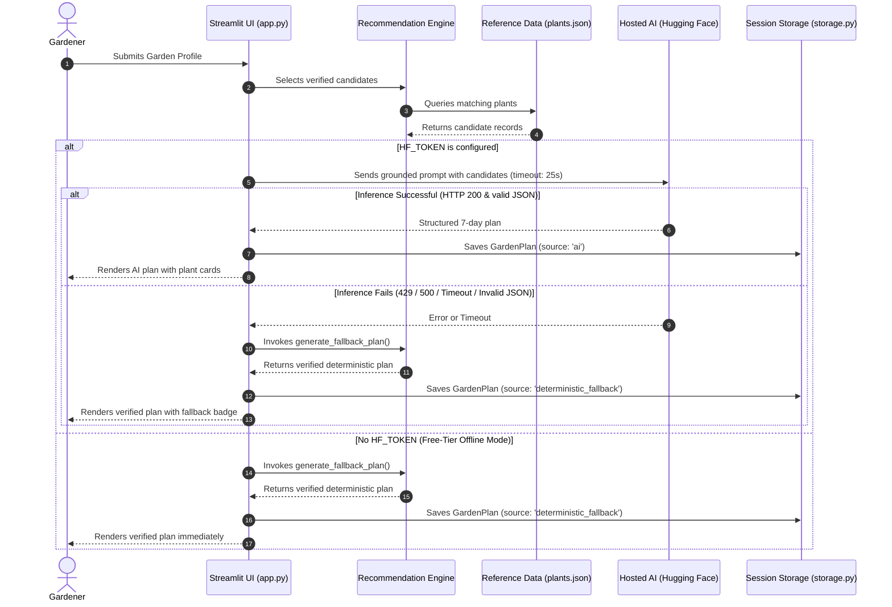
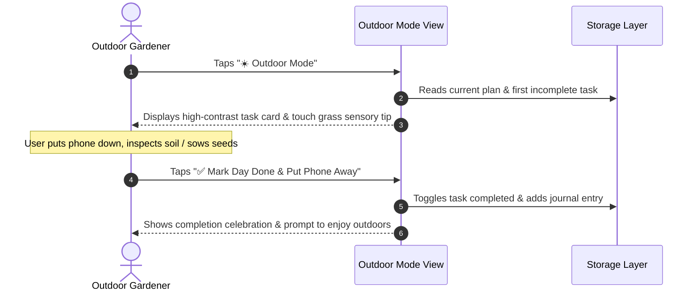

# SoilMate — System Architecture Document

**Version:** 1.0  
**Status:** MVP Implemented  
**Date:** October 11, 2026  
**Challenge:** Hacktoberfest 2026 DEV Challenge — Week 1: Touch Grass  

---

## 1. Architectural Vision

SoilMate is an open-source, mobile-responsive gardening assistant built to bridge the gap between digital gardening advice and real-world outdoor action. Its defining product philosophy is **"Grow More. Scroll Less."**

Unlike traditional applications that trap users in social feeds, forums, or endless screens, SoilMate provides a single, high-leverage outdoor task per day, backed by verified horticultural facts and accessible via an ultra-clean **Outdoor Mode**.

```
+-------------------------------------------------------------------------------+
|                               SoilMate Web App                                |
|                        (Streamlit Community Cloud)                            |
+-------------------------------------------------------------------------------+
                                        |
       +--------------------------------+--------------------------------+
       |                                                                 |
       v                                                                 v
+-------------------------------+                     +-------------------------------+
|   Hosted AI Provider          |                     |   Deterministic Fallback      |
|   (Hugging Face Inference)    |                     |   (recommendation_engine.py)  |
|   Open-Weight Serverless LLM  |                     |   Rule-Based Scoring Engine   |
+-------------------------------+                     +-------------------------------+
       |                                                                 |
       +--------------------------------+--------------------------------+
                                        |
                                        v
                       +----------------------------------+
                       |   Verified Botanical Catalog     |
                       |        (data/plants.json)        |
                       +----------------------------------+
                                        |
                                        v
                       +----------------------------------+
                       |    Portable Session & Storage    |
                       |           (storage.py)           |
                       +----------------------------------+
```

---

## 2. Component Breakdown

### 2.1 User Interface & Presentation Layer (`app.py`)
- **Framework:** Streamlit 1.38+
- **Design System:** Custom CSS palette grounded in earthy natural tones:
  - Forest Green (`#2D5A27`): Authority, nature, primary actions.
  - Terracotta (`#C86D51`): Clay pots, warm highlights.
  - Sage (`#527A52`): Secondary tags and status indicators.
  - Warm Sand (`#FAF8F5`): Low-glare, eye-resting background.
  - Dark Soil (`#1F291E`): High-contrast, readable typography.
- **Views:**
  1. **🌱 Garden Planner:** User intake form (city, garden type, sunlight, space, goal) with instant plan generation.
  2. **📋 7-Day Outdoor Plan:** Daily interactive checklist with touch-grass sensory tips and progress tracking.
  3. **☀️ Outdoor Mode:** High-contrast, large-button, distraction-free view designed specifically for mobile outdoors in direct sunlight.
  4. **📖 Garden Journal:** Observation notes, plant tracking, and deletion capability.
  5. **🌿 Plant Library:** Interactive searchable reference catalog with expandable scientific profiles.
  6. **⚙️ Settings & Backup:** AI connection status, JSON backup export, backup restore, and reset triggers.

### 2.2 Domain Models & Horticultural Reference (`garden_data.py`, `data/plants.json`)
- **Pydantic v2 Models:** Enforces strict typing and validation across all entities:
  - `Plant`: Botanical name, category, sunlight hours, minimum container depth, watering frequency, seasonal windows, companion species, and touch-grass actions.
  - `GardenProfile`: User location, garden type, sunlight tier, space footprint, goal, and experience level.
  - `TaskItem`: Daily scheduled outdoor gardening tasks with time estimates.
  - `GardenPlan`: Complete 7-day schedule, recommended plants, preparation steps, and verification notes.
  - `JournalEntry`: User observation logs with timestamps and tags.
- **Reference Catalog (`data/plants.json`):** 15 verified varieties covering herbs, vegetables, and companion flowers cross-referenced with Royal Horticultural Society (RHS) and university agricultural extension manuals.

### 2.3 Hybrid AI & Recommendation Pipeline (`ai_service.py`, `recommendation_engine.py`)
- **Primary AI Path (Hosted Open-Weight Inference):**
  - Uses Hugging Face Inference Providers (serverless endpoints).
  - Open-weight models (e.g. `meta-llama/Llama-3.2-3B-Instruct` or `Qwen/Qwen2.5-7B-Instruct`).
  - **Grounding Strategy:** Prompt explicitly passes candidate plant objects from `plants.json`. The AI is instructed to synthesize a plan *only* from verified candidates, preventing botanical hallucinations.
  - Strict response sanitization: extracts JSON from markdown blocks, validates against Pydantic schema.
- **Fail-Safe Fallback (Deterministic Horticultural Engine):**
  - Zero external network dependency.
  - Multi-criteria scoring algorithm evaluating sunlight compatibility, container volume, space footprint, experience level, and user goals.
  - Generates comprehensive 7-day action plan with verified care instructions.
  - Seamlessly activates when `HF_TOKEN` is missing, rate-limited (HTTP 429), or when serverless endpoints return 500/timeout.

### 2.4 State Management & Data Portability (`storage.py`)
- **In-Memory Session State:** Native `st.session_state` persistence for active plans, task completion states, and journals.
- **Portable JSON Backup:** Allows users to download a complete export (`soilmate_backup.json`) and restore it on any device or browser session with full integrity validation.
- **Zero Cloud Tracking:** No user data is transmitted to third-party databases by default, maintaining ₹0 infrastructure costs and total user privacy.

---

## 3. Request Flow Diagrams

### 3.1 Plan Generation & Fallback Sequence



### 3.2 Outdoor Mode & Touch Grass Flow



---

## 4. Security & Privacy Architecture

1. **Credential Isolation:** API tokens (`HF_TOKEN`) are accessed strictly via Streamlit secrets or environment variables. No credentials are leaked to frontend code, git commits, or client logs.
2. **Deterministic Fail-Safe:** The application functions fully without any API credentials.
3. **Data Sovereignty:** Profiles and journal logs reside entirely in the user's browser session with one-click JSON export/import. No personal garden data is stored in unmanaged databases.
